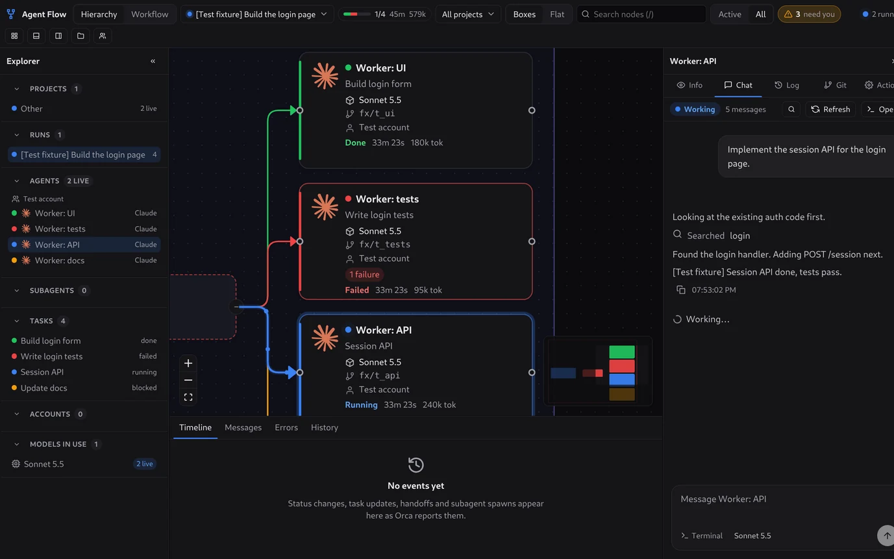

# Agent Flow for Orca



A live, n8n-style canvas of everything your agents are doing in [Orca](https://github.com/stablyai/orca):
lead orchestrators, workers, Claude subagents, tasks and their dependencies, handoffs between agents,
worktrees, reviews, tests, failures and retries, with controls to act on them.

Everything on the canvas comes from Orca's real runtime. Nothing is simulated: a node only shows as
running while Orca reports live activity for it, values Orca does not expose are marked
"Not available from Orca", and inferred values (such as a task's kind) are labelled as inferred.

## Active by default

The canvas opens on **Active**: only agents Orca reports as working, waiting for input or blocked
right now, plus whatever connects them (their lead, team, parent agent) and their live subagents.
Switch to **All** in the toolbar to see finished runs and history.

Every agent node shows the real logo of the AI it runs (Claude, OpenAI/Codex, Gemini/Antigravity,
Cursor, GitHub Copilot, and others); agents without a published mark get a monogram. The marks are
trademarks of their owners and are used only to identify which AI an agent runs (path data from
[Simple Icons](https://simpleicons.org), CC0).

## Project boxes

By default every agent sits in a box for the project it works in, n8n-style: each box shows the
project name and path, how many agents are live, and the logos of the AIs inside. Boxes can be
moved, resized and collapsed, and the toolbar's project picker shows one project at a time
(**Flat** turns the boxes off).

An agent's project is decided in this order:

1. **Your path rules** (folder icon in the toolbar): a folder or glob (`~`, `*`, `**`) → box name,
   e.g. `~/Code/acme/** → Acme`. Rules win over everything below.
2. The project Orca names for the agent (orchestration dispatches carry it).
3. The worktree's own `.git` pointer (exact repository).
4. Orca's project for that worktree, or the project's root folder. A project rooted at your home
   folder only matches agents working directly in it, so it never swallows everything.
5. Orca's worktree layout (`<workspaces>/<project>/<worktree>`), so removed worktrees still land in
   the right box.
6. Otherwise **Other**.

A run's lead sits in the project where most of its workers are; a worker in another project stays
in that project's box and the edge crosses between boxes. Boxes can be renamed and colored in the
same dialog.

## Two views, one state

- **Hierarchy**: who works for whom. Lead orchestrator → teams (by account) → workers → subagents.
  Agents outside an orchestration run are grouped by worktree. Finished workers fold into a
  collapsible "Finished (N)" group.
- **Workflow**: how work flows. Run → tasks as a dependency DAG → worktrees, with decision gates as
  blocker nodes. Finished tasks that nothing waits on fold away.

Switching views never touches your agents.

Edges are coloured by status and animate only with verified activity:

| Status | Edge |
| --- | --- |
| Running | blue, moving particles |
| Review / testing | purple, moving particles |
| Ready | neutral line |
| Blocked | amber |
| Failed | red |
| Done | green |
| Cancelled | muted dashed |

Agent-to-agent messages (handoffs, `worker_done`, questions) appear as animated message edges for a
minute after they are sent. Animation respects `prefers-reduced-motion` and is capped at 150 edges.

## Where to open it

| Surface | How |
| --- | --- |
| Sidebar panel | The **Agent Flow** icon in Orca's right sidebar, or click **Agent Flow** in the status bar |
| Full canvas | Tab bar **+** → **New Agent Flow canvas** (or open any `.agentflow` file). Layout and node positions are saved in that file. |
| Browser dashboard | Toolbar ↗ button → **Turn on**, or the command **Agent Flow: Show browser dashboard link**. Opens `http://127.0.0.1:<port>/#token=…` |

Keyboard: `1` hierarchy, `2` workflow, `f` fit, `l` auto-layout, `/` search, `Enter` inspect,
`Esc` clear selection. Right-click a node for its actions; Shift-drag to select several.

## Subagents

Claude subagents appear under the agent that spawned them, for **every** Claude session (chat
tabs and terminals), live while they run, with their own conversation in the Output tab. Agent
Flow reads the files Claude Code itself writes
(`~/.claude/projects/<project>/<session>/subagents/*.meta.json` and `.jsonl`, also inside each
Orca-managed account profile), locally and read-only. Orca's tool hooks add instant detection for
agents in terminals, and both sources merge into one node (same tool-call id).

## Chat view

The inspector's **Output & prompt** tab shows the agent's conversation as a chat, built on
[assistant-ui](https://www.assistant-ui.com): your messages and the agent's replies as bubbles,
markdown and code, collapsible thinking and tool-call cards (each tool's input and output), the
model and effort of each reply, and images inline: screenshots tools returned and images you
pasted show as thumbnails and open full size on click (loaded on demand). The composer at the
bottom sends to the agent:

| Agent | How the message is delivered |
| --- | --- |
| Terminal agent | Typed into its terminal and submitted (`terminal.sendText`) |
| Chat session (incl. chat-mode workers) | Posted into the chat like typing in its tab, queued if the agent is busy. **Experimental**: Orca's plugin API has no way to do this yet, so Agent Flow uses Orca's own local runtime connection (the `orca` CLI and Orca's mobile app use the same one) for `agentSession.send` only. The first message to each chat asks for confirmation. Turn it off with the *Send prompts into chat sessions* setting. A proposed official API is in [`upstream/`](upstream/). |
| Terminal-less orchestration worker | Orchestration message (`orca orchestration send`); coordinator rules apply |
| Subagent | Not possible (it only takes its brief from its parent) |

Model and effort come from the agent's own session files (Claude: each reply's `model` and
`effort`; Codex: each `turn_context`), so they are real values, updated when they change.

## Inspector

For the selected node: overview (agent, model, effort, account and how it was identified, duration,
tokens, worktree, branch, session, dispatch, outcome), the current task (spec, acceptance criteria,
result, files modified, dependencies, attempts), **Output** (the agent's recorded conversation with
collapsible tool calls: from Orca's orchestration transcript for workers, from Claude Code's own
session file for Claude sessions and subagents, otherwise terminal output) with a **prompt
composer**, **Activity**
(events, tool calls, messages), **Git** (read-only: branch, changed files, diff stat, recent commits,
conflicts) and **Controls**.

The bottom panel has the live timeline, agent messages, errors and blockers, and **History**: every
orchestration run is saved, can be **replayed** step by step (purely visual, nothing re-runs) and
**exported** as a Markdown summary.

## Controls, and what each one really does

Every control calls a documented Orca operation, is validated again in the worker, runs at most once
per click, and reports Orca's real answer. Destructive ones ask for confirmation first.

| Control | Backend | Notes |
| --- | --- | --- |
| Open terminal | host `terminal.focus` | |
| Send a prompt to an agent | host `terminal.sendText` (terminal agents); `orchestration send` (workers) | Enter sends, Shift+Enter is a new line. Chat sessions and subagents: no Orca API, so the box says why and stays disabled |
| Launch agent in a worktree | host `agent.launch` | Uses your normal Orca settings and selected account |
| Resume a past session | host `agent.resume` | |
| Create / open worktree | host `workspace.create` / `workspace.open` | |
| Stop worker | `orca orchestration worker-stop` | Confirmed; closes the worker's terminal, keeps the worktree |
| Stop a plain agent | host `terminal.close` | Only terminals Agent Flow opened, as Orca allows |
| Cancel task | `worker-stop`, then `task-update failed/cancelled` | Second step needs the coordinator (below) |
| Retry / dispatch task (pick agent, model, effort) | `orca orchestration worker-start [--retry-of]` | Coordinator only |
| New task, dependencies | `orca orchestration task-create` | Coordinator only |
| Resolve decision gate, message an agent | `gate-resolve`, `send` | Coordinator only |
| Change a running agent's model/effort | none | **Not supported by Orca**: shown disabled. Choose the model when retrying or dispatching instead. |
| Pause / resume an agent | none | **Not supported by Orca** |

**Coordinator-only actions.** Orca only lets a Run's coordinator change its tasks. By default Agent
Flow shows the exact `orca orchestration …` command to run in the coordinator (with a Copy button).
If you turn on **Act as the Run coordinator** in settings and the Run's coordinator is a terminal,
Agent Flow runs it with that coordinator's handle after you confirm. Runs coordinated from a chat
session have no terminal handle, so they always use the copy-the-command path.

## Where the data comes from

| Data | Source |
| --- | --- |
| Live agent status | host event `agent.status.changed`, `agents.list`, `workspace.list` |
| Claude subagents | Claude Code's subagent files (all Claude sessions) + hooks `agent.tool.before/after` (terminal agents) |
| Conversations of Claude sessions | Claude Code's session transcript (`<session>.jsonl`), tail only |
| Runs, tasks, dependencies, workers, model/effort, retries | `orca orchestration run-list / run-show / task-list / worker-list / worker-show` |
| Messages and handoffs | `orca orchestration inbox` |
| Decision gates | `orca orchestration gate-list` |
| Conversations | `orca orchestration worker-read` |
| Accounts | `orca account list` |
| Which account a session uses | the agent CLI's own session file in that account's profile; fallback: the profile an agent was launched with (`agent.launch.before`) |
| Tokens, message counts | host `agent.listSessions` |

## Settings

Under **Settings → Plugins → Agent Flow**:

- **Browser dashboard** (off by default), **Dashboard port** (4790; the next free one is used),
  **Allow controls from the browser dashboard** (off by default: view-only until you turn it on).
- **Act as the Run coordinator** (off).
- **Orca CLI path**: leave empty. On many Linux desktops `/usr/bin/orca` is the GNOME *screen
  reader*; Agent Flow detects it and never runs it.

Optional **team and role labels** (toolbar 👥): name accounts ("Team A") and models or agents
("Plan reviewer"). They are stored only in this plugin's local storage, never in the code.

## Security

- The dashboard listens on `127.0.0.1` only and needs a random 256-bit token. The token is kept in
  Orca's encrypted plugin secrets, or in a `0600` file when no OS keyring is available, and a new
  one is issued every time the dashboard is turned on, so old links stop working. It travels
  in the URL fragment (never sent to the server) and then in an `Authorization` header.
- Requests with a non-loopback `Host` (DNS rebinding) or a foreign `Origin` are refused. Bodies
  must be JSON, and the dashboard can never toggle itself.
- Every command is validated strictly (unknown fields refused) in the worker. CLI arguments go
  straight to `execFile`, never a shell, and every value travels as one `--flag=value` argument,
  so free text can never be read as another flag.
- Terminal output, transcripts, specs and messages are redacted for API keys, tokens, JWTs,
  passwords and private keys before they reach any view, history file or the dashboard.
- Git inspection is read-only and limited to worktrees Orca knows about. The plugin never merges,
  pushes or force-pushes.
- Hooks only observe. They return immediately, so Claude Code never waits on Agent Flow.

## Install

From GitHub (pinned to the newest `vX.Y.Z` tag; Orca lists the access it asks for and the exact
command to approve it):

```sh
orca plugin install SokpisethNhoeun/orca-plugin-agent-flow
```

From a local checkout (development, live reload):

```sh
npm install && npm run build
orca plugin dev load .          # approve the access it lists
orca plugin open local.agent-flow
```

Requires Orca **1.4.259** or later.

## Development

```sh
npm install
npm run build       # dist/worker.mjs + dist/ui/* (committed, so Git installs need no build)
npm run watch       # rebuild on change; Orca reloads the dev plugin
npm test            # 380+ unit and integration tests (node:test via tsx)
npm run test:ui:fixture  # real clicks in Orca's browser against test data, a screenshot per step
npm run test:ui     # read-only click-through of your live dashboard
npm run check:all   # all of the above
npm run typecheck
orca plugin validate .
```

Layout: `src/shared` (contracts, validation, redaction), `src/worker` (adapters, store, commands,
dashboard, persistence), `src/ui` (React Flow canvas, nodes, edges, panels), `test/`. See
[PLAN.md](PLAN.md) for the architecture.

## Known limitations

- Orca's host API 1.9 (Orca 1.4.259) lists agents only for the focused workspace. Other
  workspaces' agents appear as soon as they change status, or right away when their agent CLI writes
  a session file (Claude).
- Subagents are shown for Claude (from its own files). Other agents do not record subagent
  identity in a way Agent Flow can read, so none are drawn for them.
- Sending into chat sessions uses an undocumented Orca runtime method (see Chat view). An Orca
  update may change it; Agent Flow then reports the failure instead of sending.
- No API to change a running agent's model or effort, or to pause it.
- Cost is not reported by Orca and is not estimated.
- Task kind (review, test, merge, plan) is inferred from the title and labelled as inferred.
- Merges are left to Orca's source-control view; Agent Flow shows conflicts and changes only.

## License

MIT
